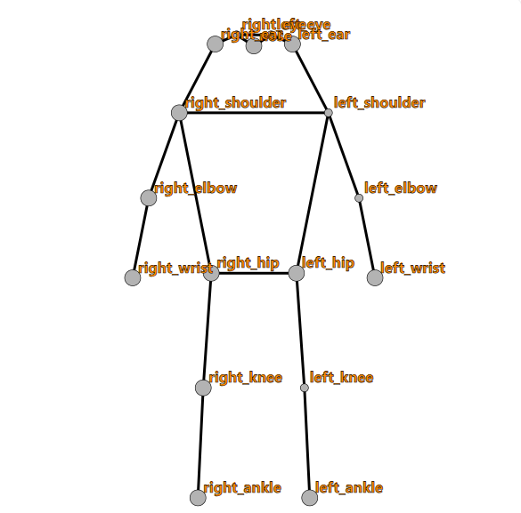
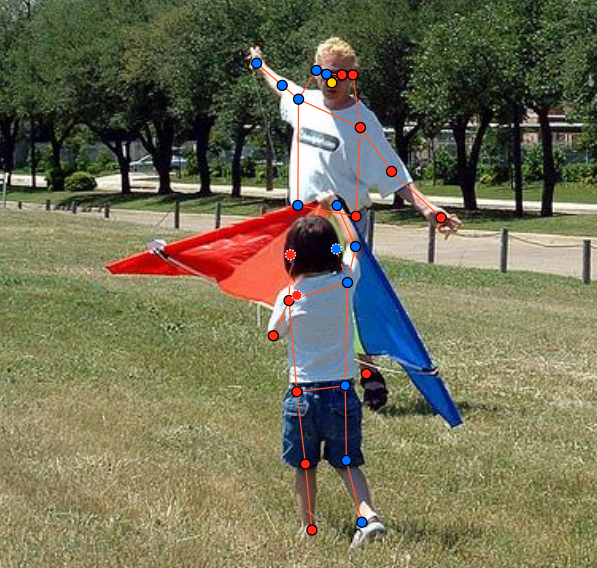
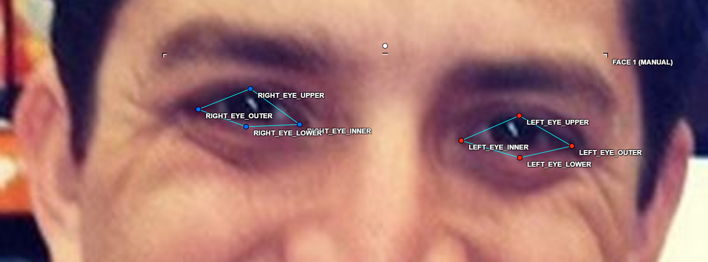
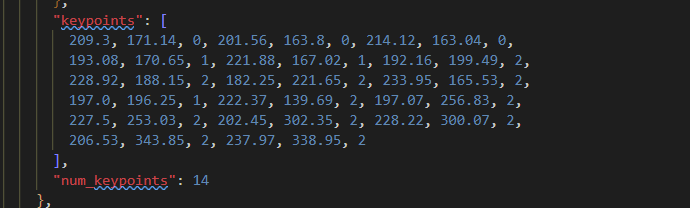

# Báo cáo cá nhân — NguyenVanQuang-2A202603200

Đổi tên file theo quy tắc `MSSV_HoTen.md`. Ví dụ: `20241234_NguyenVanAn.md`.

Dữ liệu: 12 ảnh người COCO val2017 (Lin et al., 2014) và 8 ảnh chân dung Wikimedia Commons, chỉ dùng trong lớp.

## 0. Thông tin học viên

- Họ tên: Nguyễn Văn Quang
- MSSV:2A202603200
- Email:nguyenvanquang30112k4@gmail.com
- Link repository:https://github.com/ngyenquang/K5-L2-DAY04-NguyenVanQuang-2A202603200-KeypointPose
- Phiên bản CVAT (Help → About):2.74.1
- Máy: hệ điều hành Windows 11 · RAM 8 GB · chạy CVAT chế độ lite
- Bộ ảnh (`src/exports/assignment.json` do `lab.py setup` tạo): có
- Giờ bắt đầu:17h
- Giờ kết thúc:19h30

## 1. Kiểm tra label (CP0)

| Label | Kiểu | Số điểm | Tên điểm đúng bảng của lab? | Đúng thứ tự? | Số cạnh |
|---|---|---:|---|---|---:|
| `person` | Skeleton | 17 | Có | Có | 19 |
| `face` | Skeleton | 13 | Có | Có | 13 |

Mẫu `person` dựng theo người quay mặt về camera (các điểm `left_*` nằm bên phải khung mẫu)? Có

Cách đổi cờ `occluded` / `outside` cho **một điểm** trên phiên bản CVAT này (một câu):

Rê chuột vào đúng điểm đó rồi bấm `Q` để đặt `occluded` (`v = 1`) hoặc `O` để đặt `outside` (`v = 0`) (hoặc bấm chuột phải vào điểm và chọn occluded / outside), chỉ điểm đang rê chuột bị đổi.

## 2. Số lượng đã gán và thời gian (CP1, CP2)

| Nhóm ảnh | Số ảnh | Số skeleton đã gán | Số người dưới 60 px (không gán) | Số poster / gương / màn hình bỏ qua | Thời gian (phút) |
|---|---:|---:|---:|---:|---:|
| `easy` | 5 | 5 | 4 | 0 | 18 |
| `occluded` | 3 | 6 | 0 | 0 | 14 |
| `back` | 2 | 4 | 0 | 0 | 10 |
| `small` | 1 | 2 | 7 | 0 | 16 |
| `crowd` | 1 | 3 | 0 | 0 | 12 |
| `faces` | 8 | 8 | — | 0 | 24 |

Ảnh theo nhóm: `easy` = 027565, 176000, 343057, 365099, 463932 · `occluded` = 091637, 122199, 189365 · `back` = 163118, 307757 · `small` = 572411 · `crowd` = 272026.

- Số ảnh người đã xong ở mốc phút 105: 10 / 10
- Thời gian thực tế (phút, ước lượng trong tổng 150 phút từ 17h đến 19h30): CP1 70 · CP2 24 · CP3 16
- Ảnh tốn thời gian nhất là ảnh nào, vì sao?
ảnh  000000572411.jpg vì có quá nhiều người nhiễu, người bị che khuất nhiều khó xác định những người đủ tiêu chuẩn gán skeleton

## 3. Bảng ca khó (CP1, CP2)

Mỗi điểm bạn phân vân một dòng, nhất là phân vân giữa `v = 1` và `v = 0`, hoặc không chắc hướng người.

| Ảnh | Người / mặt | Điểm | Cờ đã chọn | Phân vân giữa | Lý do chọn |
|---|---|---|---:|---|---|
| `000000091637.jpg` | người #1 (quay lưng) | `nose`, `left_eye`, `right_eye` | 0 | `v = 0` hoặc đoán vị trí | Người quay lưng, mặt không thấy, không đoán được nên đặt `outside` |
| `000000091637.jpg` | người #1 (quay lưng) | `left_ear`, `right_ear` | 1 | `v = 1` hoặc `v = 0` | Tai nằm phía sau đầu, vị trí ước lượng chắc được nên chọn `occluded` |
| `000000343057.jpg` | người #1 | `left_knee`, `right_knee`, `left_ankle`, `right_ankle` | 2 | trái/phải đúng hay đổi `lr_swap` | Thân xoay nghiêng, chân bước một trước một sau nên cặp gối và cổ chân nằm ngược phía; đối chiếu ảnh gốc thấy đúng nên giữ |

## 4. Bảng tự review (CP3)

Đi từ ảnh cuối về ảnh đầu. 5 ảnh người (ít nhất 2 ảnh `back` hoặc `crowd`) và 3 ảnh mặt. Ít nhất 8 dòng, kể cả dòng `ok`. Ghi lỗi trước, sửa sau.

Mã lỗi dùng đúng một trong: `lr_swap`, `vis_flag`, `position`, `missing`, `extra`, `ok`.

| Ảnh | Người / mặt | Điểm | Mã lỗi | Ghi chú | Đã sửa? |
|---|---|---|---|---|---|
| `face_85624.jpg` | mặt #1 | 13 điểm | `ok` | Mắt trái ở bên phải ảnh, hai khóe miệng đúng bên | Không cần |
| `face_223746.jpg` | mặt #1 (nghiêng) | `right_eye_inner` | `ok` | Mặt nghiêng, mắt xa camera bị sống mũi che nên `v = 1` | Không cần |
| `face_10579.jpg` | mặt #1 | `mouth_left`, `mouth_right` | `ok` | `mouth_left` nằm bên phải ảnh, `mouth_right` bên trái | Không cần |
| `000000343057.jpg` | người #1 | `left_knee`, `right_knee`, `left_ankle`, `right_ankle` | `ok` | Cảnh báo `lr_swap` của script, đối chiếu ảnh gốc: chân bước lệch nên gối và cổ chân nằm ngược phía thật | Không cần |
| `000000307757.jpg` | người #1, #2 (quay lưng) | vai, hông | `ok` | Hai người quay lưng, `left_*` nằm bên trái ảnh | Không cần |
| `000000272026.jpg` | người #1 (crowd) | `left_wrist`, `right_wrist` | `ok` | Cảnh báo `lr_swap`, đối chiếu ảnh gốc: tay trái chống cằm, tay phải đặt trên bàn nên cổ tay nằm ngược phía thật | Không cần |
| `000000163118.jpg` | người #1, #2 (quay lưng) | vai, hông, gối | `ok` | Hai người quay lưng, `left_*` nằm bên trái ảnh | Không cần |
| `000000122199.jpg` | người #2 | `left_knee`, `right_knee` | `ok` | Cảnh báo `lr_swap`, đối chiếu ảnh gốc: người bước dài nên gối nằm ngược phía thật | Không cần |
| `000000091637.jpg` | người #1 (quay lưng) | `nose`, `left_eye`, `right_eye`, hai tai | `ok` | Mũi và mắt `v = 0` (không thấy), tai `v = 1` (ước lượng chắc), đúng guideline | Không cần |

Tổng hợp số lỗi theo mã:

| `lr_swap` | `vis_flag` | `position` | `missing` | `extra` | `ok` |
|---:|---:|---:|---:|---:|---:|
| 0 | 0 | 0 | 0 | 0 | 9 |

Điểm còn phân vân giữa `v = 1` và `v = 0` (ghi cả hai lựa chọn và lý do chọn):

Tai của người quay lưng (`000000091637.jpg`): chọn `v = 1` thay vì `v = 0` vì tai nằm sau đầu và vị trí ước lượng chắc được. Mũi và mắt thì chọn `v = 0` vì hoàn toàn không thấy và không đoán được.

## 5. Kiểm file xuất và kết quả tự kiểm (CP4)

Tự kiểm tay trong file JSON:

| File | Người / mặt kiểm (ảnh, thứ tự) | Số phần tử `keypoints` | Điểm `outside` ra `v = 0`, `occluded` ra `v = 1`? | `num_keypoints` khớp? |
|---|---|---:|---|---|
| `NguyenVanQuang_persons.zip` | `000000027565.jpg`, người #1 | 51 | Có (không có điểm outside/occluded) | Có (17 = 17 điểm v > 0) |
| `NguyenVanQuang_persons.zip` | `000000091637.jpg`, người #1 (quay lưng) | 51 | Có (mũi, 2 mắt: v = 0; tai trái, tai phải, cổ tay trái: v = 1) | Có (14 = 14 điểm v > 0) |
| `NguyenVanQuang_faces.zip` | `face_10579.jpg`, mặt #1 | 39 | Có (cả 13 điểm v = 2) | Có (13 = 13 điểm v > 0) |

Sau khi xuất, CVAT ghi `occluded` thành `v = 1` và `outside` thành `v = 0`. Tọa độ của điểm `outside` trong file là tọa độ cũ (không phải `0, 0`).

Hai job đã chuyển sang completed trên CVAT? Có

Dán phần **TÓM TẮT** in ra từ `src/check_submission.py`:

```text
- File person: NguyenVanQuang_persons.zip
  Số ảnh: 12 · số skeleton `person`: 20 · mỗi annotation 51 số
  Skeleton theo ảnh: 000000027565=1, 000000091637=2, 000000122199=2, 000000163118=2, 000000176000=1, 000000189365=2, 000000272026=3, 000000307757=2, 000000343057=1, 000000365099=1, 000000463932=1, 000000572411=2
  Cờ v: v=2 224 (66%) · v=1 34 (10%) · v=0 82 (24%)
  num_keypoints trung bình: 12.9
- File face: NguyenVanQuang_faces.zip
  Số ảnh: 8 · số skeleton `face`: 8 · mỗi annotation 39 số
  Skeleton theo ảnh: face_10579=1, face_178208=1, face_223746=1, face_324513=1, face_449454=1, face_490361=1, face_496353=1, face_85624=1
  Cờ v: v=2 95 (91%) · v=1 9 (9%) · v=0 0 (0%)
  num_keypoints trung bình: 13.0
- Ghi chú: 82 điểm v = 0 vẫn mang tọa độ cũ (CVAT 2.x xuất như vậy; chuẩn COCO ghi 0, 0). Không phải lỗi: điểm v = 0 bị bỏ qua khi huấn luyện và khi chấm.
- Số [LỖI]: 0 · số [CẢNH BÁO]: 3
Kết quả: ĐẠT (đọc lại từng cảnh báo ở trên)
```

Các `[CẢNH BÁO]` còn giữ nguyên và lý do:

Cả 3 cảnh báo (`000000122199.jpg` #2: knee; `000000272026.jpg` #1: wrist; `000000343057.jpg` #1: knee, ankle) đều là cảnh báo "cặp trái/phải nằm ngược phía". Tôi đã mở lại ảnh gốc để kiểm tra: nhãn `left_*` / `right_*` đúng theo bên của người trong ảnh, tay hoặc chân thật sự bắt chéo nên giữ nguyên, không đổi trái/phải.

## 6. Ảnh chụp màn hình

1. Label `person` trong label constructor (đủ 17 điểm có tên):

   

2. Một người quay lưng đã gán, cờ đã đặt:

   

3. Một khuôn mặt đã gán 13 điểm, phóng to vùng mắt:

   

4. Một đoạn JSON xuất của một người:

   

Nguồn ảnh: COCO val2017 / Wikimedia Commons.

## 7. Tự đánh giá

1. Lỗi bạn mắc nhiều nhất hôm nay, và cách bạn sẽ tránh ở dự án thật:

   Rủi ro lớn nhất là nhầm trái/phải khi người quay lưng, quay nghiêng, hoặc chân tay bắt chéo, vì `left_*` là bên trái của người trong ảnh chứ không phải bên trái màn hình. Ba cảnh báo `lr_swap` của script đều rơi vào các trường hợp này. Ở dự án thật, tôi sẽ xác định hướng người trước, đặt ngay vai và hông rồi mới đặt các điểm còn lại, và chạy script tự kiểm sau mỗi lượt gán thay vì chỉ nhìn bằng mắt.

2. Một quy tắc bạn đề xuất thêm vào guideline (kèm ảnh ví dụ nếu có):

   Khi người quay lưng, ghi rõ mũi và mắt luôn là `outside` (`v = 0`), tai chỉ chọn `occluded` (`v = 1`) khi ước lượng được vị trí. Nên thêm một ảnh ví dụ người quay lưng với cờ đã đặt đúng (như ảnh `000000091637.jpg`), để mọi người gán thống nhất.

3. Nhãn của bạn đi vào model ở đâu? Chọn một lỗi bạn đã sửa và nói nó sẽ làm model học sai thế nào (heatmap, trọng số trong loss, hay bước lật ảnh):

   Nhãn đi vào model ở hai chỗ: tọa độ dùng để vẽ heatmap đích cho từng điểm, và cờ `v` quyết định điểm nào được tính vào loss (`v = 0` bị bỏ qua). Nếu nhầm trái/phải (`lr_swap`), heatmap của kênh `left_knee` sẽ đặt ở chân bên phải. Model sẽ học sai và còn sai thêm ở bước lật ảnh, vì khi lật ngang model hoán đổi các cặp `left_*` và `right_*` theo bảng cố định, nên một nhãn đổi chỗ sẽ bị hoán đổi ngược. Nhãn `v = 0` đặt sai cho điểm thật sự thấy làm mất tín hiệu học điểm đó.

## 8. Khó khăn và lỗi kỹ thuật

- **Máy ít RAM**: Docker chỉ được cấp khoảng 3,6 GB, CVAT chạy chậm, giao diện có lúc báo "Network error. The CVAT server is not reachable" và `lab.py export` một lần bị `ConnectionResetError`. Tôi chạy `python lab.py lite` để tắt các container không cần (clickhouse, grafana, vector, một số worker), đóng bớt ứng dụng khác, rồi chạy lại thì export thành công.
- **Kẹt "Connecting..." do Nuclio**: tên `nuclio` bị mạng trỏ sang địa chỉ khác nên giao diện CVAT chờ lâu. Vì lab này gán nhãn thủ công, không dùng auto-annotation, tôi đã dừng và xóa hai container `nuclio` và `nuclio-local-storage-reader`.
- **Nhầm lệnh PowerShell**: tôi gõ nguyên dấu `<` `>` trong lệnh `changepassword <username>` nên PowerShell báo lỗi; bỏ dấu đi là chạy được.
- **Cảnh báo trái/phải khi tự kiểm**: `check_submission.py` báo 3 cảnh báo cặp trái/phải ngược phía (xem mục 5). Tôi mở lại ảnh gốc để đối chiếu rồi mới giữ nguyên.


## 9. Tài liệu tham khảo và công cụ AI đã dùng

- Tài liệu trong repo: `README.md`, `docs/GUIDELINE.md`, `docs/CVAT_CHEATSHEET.md`, `CHECKPOINTS.md`, `SUBMISSION.md`.
- Dữ liệu: COCO val2017 (Lin et al., 2014) và ảnh chân dung Wikimedia Commons, chỉ dùng trong lớp.

